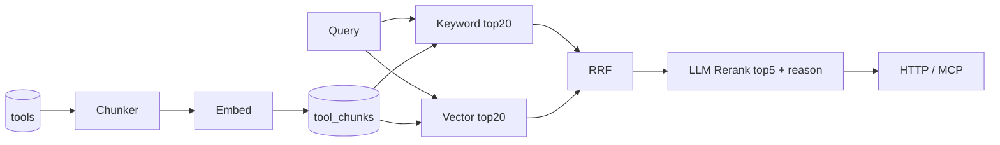

# REASONS Canvas · 工具智能检索（RAG + MCP）

- Date: 2026-11-05
- Status: active
- Related analysis: `docs/spdd/analysis/20261105-tool-rag-mcp.md`
- Related ADR: `docs/spdd/2-adr决策/ADR-20261105-tool-rag-mcp.md`
- Code anchors: `E:\AAAproject\AI_SPACE\404home`（Vue 3 + Koa + SQLite）；现有搜索 `server/routes/tools.js`（LIKE）；LLM 代理参考 `server/services/deepseek.js`

---

## R · Requirements（为什么、范围）

### Business goal

把 404Home 工具 CMS 从关键词 CRUD 搜索升级为可演示、可评测的 RAG 检索应用，并暴露 MCP 供 Cursor 自然语言检索，支撑简历句：

> 按实体切分并向量化，双路各取 20 条 RRF 融合，LLM 精排输出 top-5 与命中理由，Recall@5 由 \_\_% 提升至 \_\_%；独立开发 MCP Server 封装三个工具，接入 Cursor 实现编辑器内自然语言检索。

### In scope

- 工具实体 → chunk → embedding 索引流水线（增量重建命令）
- 双路召回（关键词 + 向量）各 top-20 → RRF → LLM 精排 top-5 + `reason`
- HTTP API + 前台演示页（增强 `/search` 或新路由 `/smart-search`）
- MCP Server 三个只读工具，stdio，可配 Cursor
- Recall@5 评测脚本 + golden 集
- P0 自动化测试（服务层 + API；MCP 可冒烟）

### Out of scope

- 联网调研 / BI / Multi-Agent
- 多租户隔离
- 强制 Qdrant（仅接口预留）
- 改 `/trial` 计费规则、微信登录

### Acceptance criteria

- [ ] `POST /api/smart-search` 返回 ≤5 条，每条含 `tool` 摘要字段 + `score` + `reason`
- [ ] 关闭 LLM 精排时仍能返回 RRF top-5（降级）
- [ ] `npm run reindex:tools`（或等价）从 DB 重建索引
- [ ] `node server/scripts/eval-recall-at-5.js` 打印 LIKE 基线 vs 新链路 Recall@5
- [ ] MCP 三个 tool 在 Cursor 可列出并调用
- [ ] 现有 `npm test` 不回归；新增 rag P0 测试绿
- [ ] Key 仅 env；前端无 Embedding/LLM 密钥

---

## E · Entities（领域对象）

| Entity | Fields / meaning | Persistence |
| --- | --- | --- |
| Tool | 现有 `tools` 行（name/summary/tags/scenario/pricing/…） | SQLite `tools` |
| ToolChunk | `tool_id`, `chunk_id`, `field`（name\|summary\|tags\|scenario\|…）, `text`, `embedding REAL[]/JSON` | SQLite `tool_chunks` |
| RetrievalHit | `tool_id`, `chunk_id?`, `score`, `source`（keyword\|vector\|rrf\|rerank） | 瞬态 |
| SmartSearchResult | `rank`, `tool`, `score`, `reason`, `matched_chunks[]` | API 响应 |
| GoldenQuery | `query`, `relevant_tool_ids[]` | `server/data/eval/smart-search-golden.json` |
| McpTool | `search_tools` / `get_tool_detail` / `list_tools_by_tag` | `404home/mcp-server` |



---

## A · Approach（方案与取舍）

### Chosen approach

1. **切分**：按工具实体字段切 chunk（至少 `name`、`summary`、`tags`、`scenario`；可选拼接「名称+摘要」整卡 chunk）。禁止把全库糊成一个大文档。
2. **双路**：  
   - 关键词：对 chunk/`tools` 做分词不强制；P0 用 SQL `LIKE` 或多字段加权打分，取 top-20 **按 tool 去重**（同工具多 chunk 取最高分）。  
   - 向量：query embedding × chunk embedding 余弦，top-20（tool 去重同上）。
3. **RRF**：`score = Σ 1/(k+rank_i)`，`k=60`；两路融合后取候选池（建议 ≤40）进精排。
4. **LLM 精排**：把候选工具摘要列表 + 用户 query 交给现有 DeepSeek 兼容聊天（复用 `services/deepseek.js` 或抽出共享 LLM client）；要求 **JSON 结构化输出**：`[{ tool_id, reason }]` 长度 5。解析失败 → 降级 RRF 顺序，`reason` 填「精排降级：RRF」。
5. **向量后端默认 SQLite**；`VECTOR_BACKEND=qdrant` 预留空实现或 throw `NOT_IMPLEMENTED`。
6. **MCP**：独立目录 `404home/mcp-server`（`@modelcontextprotocol/sdk`），stdio；内部调用检索服务（优先 `import` 同构函数；若跨进程则 HTTP `localhost:3001`，需文档说明）。
7. **UI**：`/smart-search` 懒加载页；Header/Search 入口可链过去；保留原 `/search` LIKE 行为。

### Alternatives considered

| Option | Pros | Cons | Decision |
| --- | --- | --- | --- |
| 直接上 Qdrant | 更贴课时 6 / 简历词 | 部署重，个人站运维成本高 | P0 否；接口预留 |
| 只做向量不做 RRF | 简单 | 简历句无法兑现「双路 RRF」 | 否 |
| 精排用 Cross-Encoder API | 更标准 rerank | 多一个厂商依赖 | P0 用 LLM 精排（简历已写 LLM）；接口可日后换 |
| 改写现有 LIKE `/api/tools` | 少路由 | 破坏 CMS 列表语义 | 否；新路由 |

---

## S · Structure（结构与依赖）

### Modules / files to touch

| Path | Change |
| --- | --- |
| `404home/server/db.js` | 新增 `tool_chunks` 表与迁移 |
| `404home/server/services/embeddings.js` | OpenAI 兼容 embeddings；`EMBEDDING_STUB=1` |
| `404home/server/services/toolChunker.js` | 实体切分 |
| `404home/server/services/toolRetrieve.js` | keyword / vector / RRF |
| `404home/server/services/toolRerank.js` | LLM 精排 + JSON 校验 |
| `404home/server/services/smartSearch.js` | 编排：retrieve → rerank |
| `404home/server/routes/smartSearch.js` | `POST /api/smart-search`；可选 `POST /api/smart-search/reindex`（admin） |
| `404home/server/app.js` | 挂载路由 |
| `404home/server/scripts/reindex-tools.js` | CLI 重建索引 |
| `404home/server/scripts/eval-recall-at-5.js` | Recall@5 |
| `404home/server/data/eval/smart-search-golden.json` | ≥20 条 golden |
| `404home/server/test/smart-search-p0.test.js` | P0 |
| `404home/server/.env.example` | 新 env 项 |
| `404home/mcp-server/*` | 独立 MCP 包 |
| `404home/src/views/SmartSearch.vue` | 演示页 |
| `404home/src/router/index.js` | 懒加载路由 |
| `404home/src/api/index.js` | `smartSearch()` |
| `404home/src/components/AppHeader.vue` 或 Search 入口 | 入口链接（最小改动） |
| `404home/README.md` | 第二条先看路径 |
| `docs/spdd/1|3|4-*/404home-tool-rag-mcp*` | 四层资产 |

### Dependencies / order

1. ADR + 测试边界/条例（已随本变更写入）
2. DB schema + chunker + embedding stub
3. retrieve + RRF + 单测
4. rerank + smartSearch API + 单测
5. reindex CLI + eval 脚本 + golden
6. 前台 SmartSearch 页
7. MCP server + README 配置示例

### Env（写入 `.env.example`）

```bash
# Embeddings（OpenAI 兼容，如硅基流动）
EMBEDDING_API_KEY=
EMBEDDING_BASE_URL=https://api.siliconflow.cn/v1
EMBEDDING_MODEL=BAAI/bge-m3
EMBEDDING_STUB=0

# Smart search
SMART_SEARCH_RERANK=1
SMART_SEARCH_BILLING=0
SMART_SEARCH_RATE_LIMIT_PER_MIN=20
VECTOR_BACKEND=sqlite
RRF_K=60
RETRIEVE_K=20
RERANK_TOP_N=5

# 复用现有 DeepSeek 做精排（或 STUB）
DEEPSEEK_API_KEY=
DEEPSEEK_STUB=0
```

---

## O · Operations（有序实现步骤）

> 每步写清：改哪里、做什么、完成标准。禁止只写「实现 XXX」。外部 AI **必须按 Op 顺序**，且 **先写测试再写实现**（对照 `4-测试条例/404home-tool-rag-mcp-cases.md`）。

### Op 1 · Schema + Chunker + Embedding Stub

- **Files**: `server/db.js`, `services/toolChunker.js`, `services/embeddings.js`, `test/smart-search-p0.test.js`（先写 TC 相关 assert）
- **Do**: 建 `tool_chunks`；从 tool 行生成 chunks；`EMBEDDING_STUB=1` 时返回稳定伪向量（可用文本 hash 映射到固定维，保证同文同量）
- **Done when**: 单测证明同一 tool 产生 ≥2 chunks；同文本 stub 向量相等

### Op 2 · Keyword + Vector + RRF

- **Files**: `services/toolRetrieve.js`
- **Do**: 两路各 top-`RETRIEVE_K`（默认 20），tool 级去重，RRF 融合
- **Done when**: TC 证明双路结果合并；仅一侧有命中时仍返回结果

### Op 3 · LLM Rerank + Orchestrator + HTTP

- **Files**: `services/toolRerank.js`, `services/smartSearch.js`, `routes/smartSearch.js`, `app.js`
- **Do**: `POST /api/smart-search` body `{ q: string, rerank?: boolean }` → `{ items: SmartSearchResult[], meta }`；精排失败降级
- **Done when**: API 测试：有结果 ≤5；非法空 q → 400；`DEEPSEEK_STUB=1` 可跑通

### Op 4 · Reindex CLI + Admin 可选

- **Files**: `scripts/reindex-tools.js`；可选 admin `POST /api/smart-search/reindex`
- **Do**: 清空/重建 `tool_chunks`；读全部 `enabled=1` tools
- **Done when**: CLI exit 0；chunk 数 > 0

### Op 5 · Eval Recall@5

- **Files**: `data/eval/smart-search-golden.json`, `scripts/eval-recall-at-5.js`
- **Do**: 对每条 golden：基线 = 现有 LIKE 列表 top-5；新链路 = smartSearch top-5；算 Recall@5 均值并打印表格
- **Done when**: 脚本可运行；输出可粘贴简历（允许初期新链路略优或持平，但不得崩溃）

### Op 6 · 前台演示页

- **Files**: `SmartSearch.vue`, router, api, 入口链接
- **Do**: 输入框 + 结果列表（ToolCard 或简化卡）+ 展示 `reason`；loading/empty；懒加载
- **Done when**: 本地 `npm run dev` 可演示；不引入新 UI 框架

### Op 7 · MCP Server

- **Files**: `404home/mcp-server/package.json`, `src/index.ts` 或 `index.js`
- **Do**: 工具：  
  1. `search_tools` — `{ query }` → smart search top-5  
  2. `get_tool_detail` — `{ idOrSlug }` → 单工具详情  
  3. `list_tools_by_tag` — `{ tag }` → 列表  
  README 给出 Cursor `mcp.json` 示例
- **Done when**: `npx` / `node` 启动后 tools/list 可见；调用返回 JSON

### Op 8 · 文档同步

- **Files**: `404home/README.md`；`docs/spdd/rag/knowledge/404home-tool-rag-mcp.md`；必要时改 architecture 叙事一句
- **Do**: 增加「智能检索」5 步演示路径；注明与 `/trial` 并列
- **Done when**: 新人按 README 能跑通检索 + 知道 MCP 怎么挂

---

## N · Norms（怎么写）

- Stack conventions: CommonJS 与现有 `server` 一致；MCP 包可用 ESM + TS（若引入 TS，仅限 `mcp-server/`）。前端 Options/Composition 与邻文件一致即可。
- API / error style: `{ error, code? }`；空查询 `400` + `INVALID_QUERY`；未配置 embedding 且非 stub：`503` + `EMBEDDING_NOT_CONFIGURED`。
- UI / naming: 路由 `smart-search`；文案「智能检索」；不要重做整站视觉。
- Testing: `node:test` 放 `server/test/`；`DEEPSEEK_STUB=1` + `EMBEDDING_STUB=1`；禁止单测打外网。
- 金额/JWT：本模块默认不扣费；若开 `SMART_SEARCH_BILLING=1` 必须走现有 wallet ledger，reason=`smart_search`。

---

## S · Safeguards（不许做什么）

- Must not: 删除或改坏现有 `/api/tools` LIKE 语义；把 Key 写进前端；为赶工去掉 RRF 或「双路」只留单路却仍写简历双路；引入 Python 服务成为硬依赖。
- Security: MCP 只读；reindex 需 admin；rate limit。
- Rollback / data: `tool_chunks` 可删可重建；不迁移破坏 `tools` 业务列。
- Explicit errors: 见上；禁止静默空数组掩盖配置错误（应在 `meta.warnings` 或 HTTP code 表达）。

---

## Resume evidence mapping（实现后填写）

| 简历片段 | 代码 / 脚本证据 |
| --- | --- |
| 实体切分并向量化 | `toolChunker.js` + `reindex-tools.js` |
| 双路各 20 + RRF | `toolRetrieve.js` |
| LLM 精排 top-5 + 理由 | `toolRerank.js` + API 响应 `reason` |
| Recall@5 \_\_% → \_\_% | `eval-recall-at-5.js` 输出 |
| MCP 三工具 + Cursor | `mcp-server` + 配置说明 |

---

## Sync log

| Date | Drift | Action |
| --- | --- | --- |
| 2026-11-05 | 初稿 | 创建画布与 ADR |
| 2026-11-05 | P0 落地 | Op1–8 完成；eval stub Recall@5 25%→95%；见 `404home/docs/智能检索-技术说明.md` |
