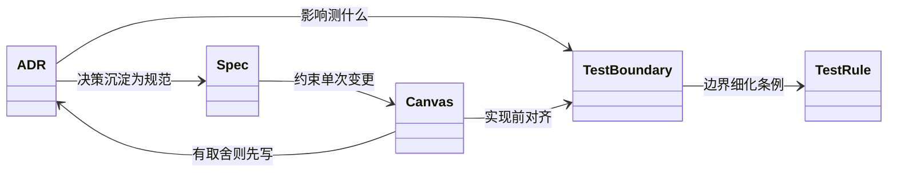

# REASONS Canvas · SPDD 资产管理（四层资产 + SDD/TDD）

- Date: 2026-10-12
- Status: synced
- Related analysis: `docs/spdd/analysis/20261012-spdd-asset-mgmt.md`
- Code anchors: `docs/spdd/`、`.cursor/rules/spdd-core.mdc`、`.cursor/skills/spdd-*`

---

## R · Requirements（为什么、范围）

### Business goal

让 SPDD 资产可分层、可审查、可配合 SDD+TDD：开发时决策与测试资产先落盘，再改规范与代码。

### In scope

- 新建四层目录及 README / 模板
- 定义资产更新顺序与 SDD+TDD 工作流
- 更新 README、workflow、Rule、Skills、RAG knowledge

### Out of scope

- 历史功能回填四层资产
- 业务代码与 CI 测试脚手架改造

### Acceptance criteria

- [x] 存在 `docs/spdd/1-资产规范` … `4-测试条例`，各有 README + 模板
- [x] `workflow.md` / `README.md` 写明：先 ADR → 测试 → 规范；SDD+TDD
- [x] `spdd-core.mdc` 与 generate/sync skills 要求及时更新四层资产
- [x] RAG `spdd-usage` + index 反映新结构

---

## E · Entities（领域对象）

| Entity | Fields / meaning | Persistence |
| --- | --- | --- |
| 资产规范 | 跨功能稳定约定（API/领域/命名/质量门） | `1-资产规范/*.md` |
| ADR | 架构/产品取舍与后果 | `2-adr决策/ADR-YYYYMMDD-*.md` |
| 测试边界 | 测什么 / 不测什么 / 风险面 | `3-测试边界/*.md` |
| 测试条例 | 可验收用例、优先级、断言意图 | `4-测试条例/*.md` |
| REASONS 画布 | 单次变更设计契约 | `canvases/`（既有） |
| RAG 知识块 | 检索用摘要事实 | `rag/knowledge/`（既有） |

---

## A · Approach（方案与取舍）

### Chosen approach

保留 `analysis/` / `canvases/` / `rag/` 作为过程与检索层；新增编号四层目录作为**稳定资产库**。开发默认 SDD+TDD：画布定契约，ADR 锁决策，测试边界+条例先于实现，规范随后对齐。

### Alternatives considered

| Option | Pros | Cons | Decision |
| --- | --- | --- | --- |
| 只扩 RAG | 改动小 | 无强制更新序、难做 TDD | 否 |
| 四层替换画布 | 资产统一 | 丢失单次变更契约粒度 | 否 |
| 编号中文目录 | 与用户一致、排序清晰 | 路径含中文 | 采用 |

---

## S · Structure（结构与依赖）

### Modules / files to touch

| Path | Change |
| --- | --- |
| `docs/spdd/1-资产规范/` | 新建 README + 模板 |
| `docs/spdd/2-adr决策/` | 新建 README + ADR 模板 + 首条元 ADR |
| `docs/spdd/3-测试边界/` | 新建 README + 模板 |
| `docs/spdd/4-测试条例/` | 新建 README + 模板 |
| `docs/spdd/README.md` | 目录与原则 |
| `docs/spdd/workflow.md` | SDD+TDD 与资产更新序 |
| `.cursor/rules/spdd-core.mdc` | 注入四层资产规则 |
| `.cursor/skills/spdd-generate/SKILL.md` | 实现前检查/更新资产 |
| `.cursor/skills/spdd-sync/SKILL.md` | 同步含四层资产 |
| `.cursor/skills/spdd-reasons-canvas/SKILL.md` | 画布关联资产路径 |
| `docs/spdd/rag/knowledge/spdd-usage.md` | 用法更新 |
| `docs/spdd/rag/index.md` | 必要时刷新条目日期感 |

### Dependencies / order

1. 目录 + 模板 + 元 ADR  
2. README / workflow  
3. Rule + Skills  
4. RAG  

---

## O · Operations（有序实现步骤）

### Op 1 · 四层目录与模板

- **Files**: `docs/spdd/1-资产规范/**` … `4-测试条例/**`
- **Do**: README 说明职责；提供空白模板；`2-adr决策` 写入本决策的元 ADR
- **Done when**: 四目录可导航，模板可复制新建

### Op 2 · 工作流文档

- **Files**: `docs/spdd/README.md`, `docs/spdd/workflow.md`
- **Do**: 画清过程层 vs 资产层；更新序；SDD+TDD
- **Done when**: 新人只读这两份能执行顺序

### Op 3 · Rule / Skills

- **Files**: `spdd-core.mdc`, `spdd-generate`, `spdd-sync`, `spdd-reasons-canvas`
- **Do**: 非琐碎改动：有决策先 ADR；再边界/条例；再规范；再代码
- **Done when**: Skill 步骤含资产检查点

### Op 4 · RAG

- **Files**: `rag/knowledge/spdd-usage.md`, `rag/index.md`
- **Do**: 沉淀四层用法与更新序
- **Done when**: index 可检索到 spdd 资产用法

---

## N · Norms（怎么写）

- 命名：`ADR-YYYYMMDD-<slug>.md`；边界/条例/规范用 `YYYYMMDD-<slug>.md` 或稳定主题名
- 一篇一主题；链接互指（ADR ↔ 边界 ↔ 条例 ↔ 规范 ↔ 画布）
- 测试条例写「意图与验收」，具体自动化测试文件路径可后补
- Stack：Markdown only for this change

---

## S · Safeguards（不许做什么）

- Must not: 跳过 ADR 做架构级改动；无测试边界/条例就宣称 TDD 完成
- Must not: 把密钥写入四层资产
- Must not: 删除既有 analysis/canvases/rag
- Rollback: 仅文档，git revert 即可

---

## Sync log

| Date | Drift | Action |
| --- | --- | --- |
| 2026-10-12 | 无（首版落地） | 建四层目录/模板/元 ADR；更新 README、workflow、Rule、Skills、RAG |
