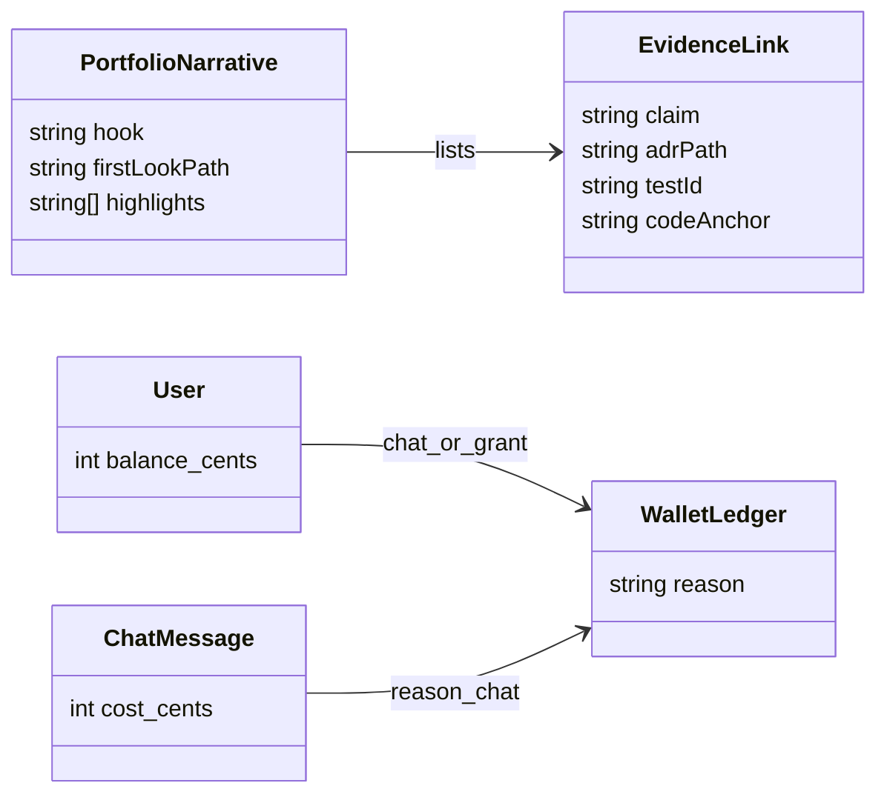

# REASONS Canvas · 作品集技术展示迭代（叙事 + 计费证据链）

- Date: 2026-10-15
- Status: synced
- Related analysis: `docs/spdd/analysis/20261013-portfolio-tech-showcase.md`
- Code anchors: `404home/README.md`、`404home/src/views/Trial.vue`、`404home/server/routes/chat.js`、`404home/server/routes/wallet.js`、`404home/server/services/wallet.js`、`404home/server/test/`

---

## R · Requirements（为什么、范围）

### Business goal

在求职窗口内，把 404Home 从「对内可用的导航站」改造成资深前端/全栈前端 **5–15 分钟可审查的工程作品集**：钩子是可演示的 DeepSeek 试用计费闭环，证据是 ADR + 自动化测试 + 代码锚点；CMS 导航降为宿主背景。

### In scope

- **阶段 A**：对外叙事入口（README 或 `docs/portfolio.md`）「先看路径」+ 3 个面试故事链到已有 ADR。
- **阶段 B**：Trial 计费闭环的**演示验收**加固；把 wallet / deepseek-chat 的 **P0 条例落到自动化测试**（延续 `ADR-20261013-test-stack`）；Demo 演示账号与额度恢复约定（seed 或 admin-credit 文档步骤）。
- **阶段 C（本画布内只锁决策，实现可拆 follow-up）**：选定一条现代化切片并先写 ADR——默认推荐 **C3 性能基线**（工期可控）；Vite（C1）列为显式备选，不与 B 并行半开。
- 作品集窗口 **冻结低信号功能**（见 Out of scope）。

### Out of scope

- 微信 OAuth、微信支付、短信、小程序。
- 资讯/教程内容运营扩张、工具收录运营。
- 多模型路由、Agent、微前端、流式 SSE。
- 全仓 TypeScript 化（可作阶段 D）。
- 把管理后台 CRUD 当面试主线。
- Playwright E2E（可选后续；本画布不强制）。
- 另起无关玩具 Demo 仓库。

### Acceptance criteria

- [x] 陌生人打开 README，能在 **5 步内**走完：注册/登录 → `/trial` → 发消息 → 看到余额下降（或明确的 `INSUFFICIENT_BALANCE` / `DEEPSEEK_NOT_CONFIGURED` 说明）。
- [x] README「技术亮点」每条可点到：**规范段落 + ADR + ≥1 条自动化用例**（或明确标注「手测 / 待补」）。
- [x] `npm test` 覆盖 chat P0：`TC-01`（Stub 扣费+ledger）、`TC-02`（余额不足）、`TC-03`（无 Key）、`TC-06`（未登录 401）；wallet P0：`TC-02`/`TC-03`（admin-credit 与 user 不可 credit）至少落地。
- [x] 存在固定演示路径说明：演示账号或「注册即赠 300 分」+ admin 加额恢复方式；**无密钥进 git**。
- [x] 落 ADR：`作品集窗口范围冻结` + `ADR-20261015-perf-baseline`（C3；路由已懒加载，记录 build 体积）。
- [x] 面试可口述 3 故事：双角色 JWT、分账用分、登录缓存仅邮箱——均能指到现有 ADR/测试。

---

## E · Entities（领域对象）

| Entity | Fields / meaning | Persistence |
| --- | --- | --- |
| PortfolioNarrative | 一句话定位、先看路径、亮点清单、非目标 | `404home/README.md` 和/或 `docs/portfolio.md` |
| EvidenceLink | 主张 → 规范 / ADR / 测试 TC / 代码锚点 | Markdown 链接表 |
| DemoScript | 演示账号策略、额度恢复、Key 缺失时的降级话术 | README + seed/文档；密钥仅 env |
| User / WalletLedger / ChatSession | 既有领域（演示依赖） | SQLite（既有） |
| PortfolioFreeze | 窗口内禁止扩张的功能清单 | ADR |

---

## A · Approach（方案与取舍）

### Chosen approach

1. **不另起项目**：在现有 404Home + SPDD 上做「叙事重定位 + 证据闭合」。
2. **默认受众**：资深前端 / 全栈前端（AI 应用前端叙事作为亮点之一，不独占标题）。未书面确认前按此默认执行；确认后只改 README 措辞与阶段 C 选型。
3. **交付序**：A（README）→ B（测试+演示加固）→ C（单一现代化 ADR+实现）。禁止 A/C 并行大改构建链。
4. **阶段 C 默认**：先做 **C3 性能基线**（路由懒加载核对、构建产物体积备注、可选 Lighthouse 数字写入规范）；**不做**本窗口 Vite 全量迁移，除非用户明确改选 C1。
5. Chat 自动化：**Stub DeepSeek**（CI/本地默认可跑），与 `3-测试边界/404home-deepseek-chat.md` 一致。

### Alternatives considered

| Option | Pros | Cons | Decision |
| --- | --- | --- | --- |
| 另起精简 Demo 仓 | 干净 | 丢掉 SPDD/真实复杂度 | 否 |
| 先 Vite 再补测试 | 栈看起来新 | 迁移噪音大、证据链仍断 | 否（默认）；可升为 C1 |
| 先补全九模块自动化 | 覆盖全 | ROI 低、窗口不够 | 否；只做 wallet/chat P0 |
| 主打 CMS/工具列表 | 页面多 | 信号弱 | 否；降为宿主 |
| 主叙事写 SPDD/AI 协作 | 差异化 | 易被判「不会手搓」 | 附录；主叙事=计费试用工程 |

---

## S · Structure（结构与依赖）

### Modules / files to touch

| Path | Change |
| --- | --- |
| `docs/spdd/2-adr决策/ADR-20261015-portfolio-freeze.md` | **新建**：作品集窗口范围冻结 + 受众默认 + 阶段 C 默认 C3 |
| `docs/spdd/2-adr决策/ADR-20261015-perf-baseline.md`（或 Vite） | 阶段 C 时新建；本画布 Op 可后置 |
| `docs/spdd/3-测试边界/404home-wallet.md` | 补 Environments/CI：临时 DB；关联 portfolio 画布 |
| `docs/spdd/3-测试边界/404home-deepseek-chat.md` | 明确 Stub 注入方式与 CI Forbidden |
| `docs/spdd/4-测试条例/404home-wallet-cases.md` | `Code tests` 指向新测试文件 |
| `docs/spdd/4-测试条例/404home-deepseek-chat-cases.md` | 同上 |
| `docs/spdd/1-资产规范/404home-architecture.md` | 可选：加「对外叙事主角=Trial 计费」一句 |
| `404home/README.md` | 重写钩子、先看路径、证据表、非目标 |
| `docs/portfolio.md`（可选） | 若 README 需保持双语/对内运维，则对外故事放这里并双向链接 |
| `404home/server/test/wallet-p0.test.js` | **新建**：admin-credit / user 拒 credit / 非负 |
| `404home/server/test/chat-billing-p0.test.js` | **新建**：Stub 扣费、余额不足、无 Key、401 |
| `404home/server/test/helpers.js` | 扩展：Stub fetch / 无 Key 环境 / 清余额辅助 |
| `404home/server/routes/chat.js` 等 | **仅当**测试需要可注入 Stub 时做最小改动（保持行为不变） |
| `404home/src/views/Trial.vue` | 仅修演示缺口（余额刷新、错误码展示）；无大改 UI |
| `404home/server/seed.js` | 可选：演示用户种子（无真实密码明文进文档以外的约定） |

### Dependencies / order

1. ADR 作品集冻结（有取舍，最先）
2. 更新 wallet/chat 测试边界与条例的「Code tests / Stub」说明
3. 写自动化测试（TDD：先红后绿若行为已存在则先写断言对齐条例）
4. README / portfolio 叙事（依赖测试文件路径可链）
5. 必要时微修正 Trial / chat 注入点
6. 阶段 C ADR + 实现（独立 follow-up，不阻塞 A/B 验收）
7. 需要时改 `1-资产规范`；稳定摘要进 RAG

---

## O · Operations（有序实现步骤）

> generate 时资产序：**ADR → 测试边界/条例 → 规范 → 代码（SDD+TDD）**。

### Op 1 · 落 ADR：作品集窗口冻结

- **Files**: `docs/spdd/2-adr决策/ADR-20261015-portfolio-freeze.md`
- **Do**: 记录决策——主角=Trial 计费；冻结微信/支付/资讯扩张/微前端；受众默认资深/全栈前端；阶段 C 默认 C3；整仓继续用现有 GitHub 叙事（不强制拆仓）。
- **Done when**: ADR status=accepted；分析文档 Open Questions 中可标默认假设。

### Op 2 · 对齐 wallet/chat 测试资产

- **Files**: `docs/spdd/3-测试边界/404home-wallet.md`、`404home-deepseek-chat.md`；`docs/spdd/4-测试条例/404home-wallet-cases.md`、`404home-deepseek-chat-cases.md`
- **Do**: 边界写明 Stub/临时 DB；条例 `Code tests` 改为将指向的文件路径；Related canvas 链到本画布。
- **Done when**: 条例 P0 与计划中的 `*.test.js` 一一对应，无「待补」笼统句（未做的 TC 标 P1/延后）。

### Op 3 · 实现 chat/wallet P0 自动化

- **Files**: `404home/server/test/helpers.js`、`chat-billing-p0.test.js`、`wallet-p0.test.js`；必要时最小改 `routes/chat.js` / deepseek 调用处以支持 Stub
- **Do**: 按条例写测试；CI/本地无真实 Key 可绿；断言 ledger reason、`INSUFFICIENT_BALANCE`、`DEEPSEEK_NOT_CONFIGURED`、401、user 不能 admin-credit。
- **Done when**: 在 `404home/` 执行 `npm test`（或 `test:server`）上述用例通过；条例 Traceability 已填。

### Op 4 · 演示路径加固（产品可点）

- **Files**: `404home/src/views/Trial.vue`（若余额/错误码未回写则修）；`404home/README.md` 演示节；可选 `seed.js`
- **Do**: 确认登录后发消息余额 chip 更新；余额 0 / 无 Key 有可读错误；README 写清 5 步与「无 Key 时面试话术」。
- **Done when**: 本地按 README 5 步可完成或可解释失败码；无密钥写入仓库。

### Op 5 · 对外 README / 证据表

- **Files**: `404home/README.md`；可选 `docs/portfolio.md`
- **Do**: 一句话定位；架构简图（文字表即可）；先看路径；亮点→证据链接表（双角色 JWT、分账、邮箱缓存、服务端代理、npm test）；非目标；SPDD 链到 `docs/spdd/README.md` 作附录。
- **Done when**: 去掉「仅导航站」主叙事；面试官按「先看」无需问你就能点到 ADR。

### Op 6 ·（可选后续）阶段 C 性能基线

- **Files**: `docs/spdd/2-adr决策/ADR-20261015-perf-baseline.md`；`404home/src/router/index.js`；`1-资产规范/404home-architecture.md` 性能小节
- **Do**: 核对路由懒加载；记录 build 产物量级或 Lighthouse 一次基线；写入规范「作品集期保持」。
- **Done when**: ADR accepted + README 亮点多一条可引用数字/结论。若用户改选 Vite，本 Op 替换为迁移 ADR，且不与未完成的 Op 3 并行。

### Op 7 · 同步分析与 RAG（收尾）

- **Files**: `docs/spdd/analysis/20261013-portfolio-tech-showcase.md`；按需 `docs/spdd/rag/knowledge/404home-overview.md` + `rag/index.md`
- **Do**: 分析 Status/Open Questions 按默认假设更新；overview 一句改为「作品集主角=试用计费」。
- **Done when**: 分析 Related canvas 指向本文件且不再写「待生成」。

---

## N · Norms（怎么写）

- Stack conventions: 延续 Vue 3 + Koa + SQLite；测试用 `node:test` + vitest（既有 ADR）；不引入第二套文档体系。
- API / error style: `{ error, code? }`；聊天相关 `INSUFFICIENT_BALANCE` / `DEEPSEEK_NOT_CONFIGURED`。
- UI / naming: Trial 为作品集主路径；Header 仍不展示「管理」；视觉不换皮。
- Testing: 条例编号与 `it('TC-xx: ...')` 对齐；DeepSeek **Stub 优先**；禁止测试依赖生产 Key。
- Docs: 对外英文/中文均可，但「先看路径」必须短；证据用相对路径链到 `docs/spdd/`。

---

## S · Safeguards（不许做什么）

- Must not: 为简历同时开 Vite + TS + E2E + 微信；把密钥、SSH、真实充值凭证写进 README/seed 明文仓库。
- Must not: 删除或弱化双角色隔离、账本、密码不进 localStorage 等已有硬约束来「简化 Demo」。
- Security: Demo 防刷仍靠验证码 + 服务端代理；生产禁止关验证码。
- Rollback / data: 测试只用 `DB_PATH` 临时库；不碰生产 `404home.db`。
- Explicit errors / HTTP codes: 未登录聊天 401；余额不足与无 Key 必须带约定 `code`，禁止静默空响应。

---

## Sync log

| Date | Drift | Action |
| --- | --- | --- |
| 2026-10-15 | 分析已 ready、画布此前缺失 | 新建本画布为 active |
| 2026-10-15 | generate Op1–5、7 完成；Op6 性能基线未做 | 标 synced；阶段 C 留 follow-up |
| 2026-10-18 | Op6：路由已是懒加载，补体积基线 ADR | `ADR-20261015-perf-baseline`；规范规则 11；README 亮点一行 |
