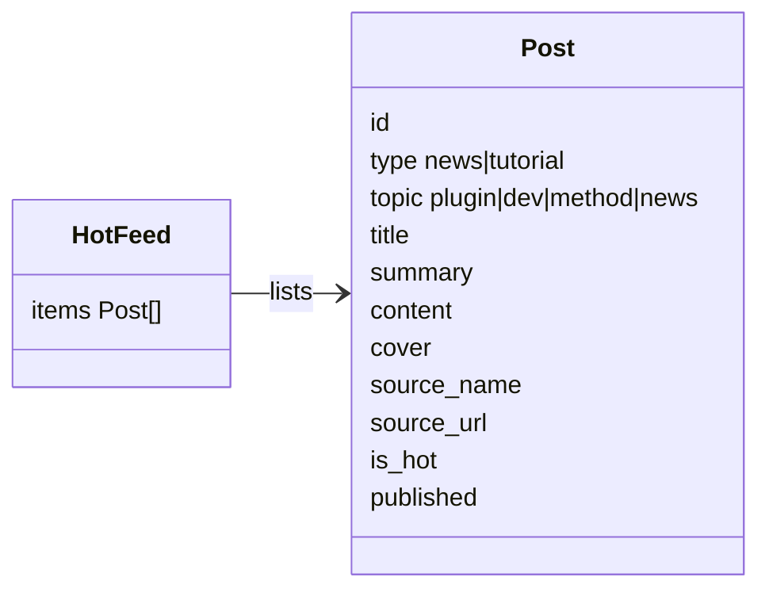

# REASONS Canvas · 首页热门文章专区

- Date: 2026-10-21
- Status: synced
- Related analysis: `docs/spdd/analysis/20261021-hot-articles-home.md`
- Related ADR: `docs/spdd/2-adr决策/ADR-20261021-hot-articles-home.md`
- Related tests: `3-测试边界/404home-hot-articles.md` · `4-测试条例/404home-hot-articles-cases.md`
- Code anchors: `404home/src/views/Home.vue`、`404home/server/db.js`、`404home/server/routes/posts.js`、`404home/server/seed.js`、`404home/src/components/AppHeader.vue`、`404home/src/views/PostDetail.vue`

---

## R · Requirements（为什么、范围）

### Business goal

把 `/` 做成 AI 图文热门专区（插件 / 开发 / 方法论 / 新闻），站内可读全文并注明出处；工具导航降为首页次级；主题切换改为电灯泡，色板不变。

### In scope

- `posts` 扩展：`topic`、`source_name`、`source_url`、`is_hot`；migrate 兼容旧库。
- API 支持 `topic`、`hot` 查询；CRUD 接受新字段。
- seed/ingest ≥20 条站内整理稿（封面 + 正文 + 出处），四类 topic 均有覆盖。
- `Home.vue`：中文热门站常见布局——顶部分类 tab、主栏左图右文/卡片列表、右栏热榜；下方「热门工具」条。
- `PostDetail` 展示出处链接。
- Header：电灯泡按钮（亮=light，灭=dark）。
- admin `Posts.vue` 可编辑新字段（最小必要）。

### Out of scope

- 定时爬虫、独立中台服务、UGC
- 改色板 / 新 UI 库
- 删除工具分类路由；大改 `/news` `/tutorials` 列表（侧栏可仍读 type）

### Acceptance criteria

- [x] `/` 主视觉为热门文章 Feed；仍有热门工具区块
- [x] DB/API 暴露 topic/source/is_hot；`GET ?topic=&hot=1` 可用
- [x] ≥20 条已发布图文，详情站内正文 + 出处
- [x] 灯泡切换亮暗，键仍为 `404home-theme-pref`
- [x] P0 自动化：`hot-articles-p0.test.js` 覆盖 TC-01–05

---

## E · Entities（领域对象）

| Entity | Fields / meaning | Persistence |
| --- | --- | --- |
| Post | 既有 + `topic` plugin\|dev\|method\|news；`source_name`；`source_url`；`is_hot`；`cover`；站内 `content` | SQLite `posts` |
| HotFeed | 首页已发布热门/最新文章列表 | API 派生 |
| ThemeBulb | 解析后 light/dark → 亮/灭图标 | `useTheme` + Header |

---

## A · Approach（方案与取舍）

### Chosen approach

1. **产品（独立开发者）**：内容用「站内整理稿 + 出处」而非违规镜像爬取；首页 B 方案保工具发现；seed 一次灌满 20 条可演示。
2. **Schema**：`ALTER` 加列 + 新建库 CREATE 含新列；`topic` 默认 `news`；`is_hot` 默认 0。
3. **首页**：重写 `Home.vue` 布局（CSS 变量）；新建轻量 `ArticleCard.vue`（或内联，优先小组件复用）；右栏热榜 `is_hot`。
4. **封面**：`public/covers/hot-01.svg` … 本地静态，免外链失效。
5. **灯泡**：替换 `AppHeader` 滑块为 icon button；`aria-label` 保留。

### Alternatives considered

| Option | Pros | Cons | Decision |
| --- | --- | --- | --- |
| 真爬虫 | 内容新 | 合规/运维爆 | 否，seed 整理稿 |
| `/` 纯文章 + `/tools` | IA 干净 | 多路由迁移 | 否，保工具条 |
| 只改 type 枚举 | 字段少 | 破坏 SidePanel | 否，加 topic |

---

## S · Structure（结构与依赖）

### Modules / files to touch

| Path | Change |
| --- | --- |
| `docs/spdd/2-adr决策/ADR-20261021-hot-articles-home.md` | 已接受 |
| `docs/spdd/3-测试边界/404home-hot-articles.md` | 已写 |
| `docs/spdd/4-测试条例/404home-hot-articles-cases.md` | 已写 |
| `docs/spdd/3-测试边界/README.md` / `4-测试条例/README.md` | 索引行 |
| `docs/spdd/1-资产规范/404home-architecture.md` | CMS posts 字段一句 |
| `404home/server/db.js` | schema + migrate + parsePost |
| `404home/server/routes/posts.js` | query/CRUD 新字段 |
| `404home/server/seed.js` | ≥20 热门图文 |
| `404home/server/test/hot-articles-p0.test.js` | P0 |
| `404home/public/covers/*.svg` | 封面 |
| `404home/src/views/Home.vue` | Feed 布局 |
| `404home/src/components/ArticleCard.vue` | 图文卡（若拆） |
| `404home/src/views/PostDetail.vue` | 出处 |
| `404home/src/components/AppHeader.vue` | 灯泡 |
| `404home/src/views/admin/Posts.vue` | 表单字段 |
| `404home/src/api/index.js` | 无需大改（query 透传） |

### Dependencies / order

1. ADR + 测试边界/条例（本画布前已齐）
2. 规范轻补 → 红测 → schema/API/seed → 绿
3. Home / Detail / Header / admin UI
4. 手测灯泡与首页

---

## O · Operations（有序实现步骤）

### Op 1 · 资产索引与规范一句

- **Files**: `3-测试边界/README.md`、`4-测试条例/README.md`、`1-资产规范/404home-architecture.md`
- **Do**: 挂上热门文章模块；architecture CMS 行注明 posts 扩展字段。
- **Done when**: README 可点到边界/条例；规范有字段说明。

### Op 2 · TDD：热门文章 P0 红测

- **Files**: `404home/server/test/hot-articles-p0.test.js`（参考 helpers）
- **Do**: 按条例 TC-01–05 写失败测试。
- **Done when**: 跑测失败原因是缺字段/缺数据，而非 setup 错。

### Op 3 · Schema migrate + API

- **Files**: `db.js`、`routes/posts.js`
- **Do**: 加列与查询/写入；非法 topic → 400。
- **Done when**: TC-01–03、TC-05 绿。

### Op 4 · Seed ≥20 + 封面

- **Files**: `seed.js`、`public/covers/*`
- **Do**: 灌四类 topic 热门文；cover 指本地 SVG。
- **Done when**: TC-04 绿。

### Op 5 · 首页 Feed + 详情出处

- **Files**: `Home.vue`、`ArticleCard.vue`（可选）、`PostDetail.vue`、`SidePanel` 若需
- **Do**: 中文热门布局；主栏文章；下栏热门工具；详情出处。
- **Done when**: 手测 `/` 与详情符合 Acceptance。

### Op 6 · 电灯泡主题按钮 + admin 字段

- **Files**: `AppHeader.vue`、`admin/Posts.vue`
- **Do**: 灯泡 UI；admin 可编 topic/source/is_hot。
- **Done when**: 切换持久化；后台能改新字段。

---

## N · Norms（怎么写）

- Stack: Vue 3 + Koa + SQLite；颜色只用 `var(--*)`。
- API: `{ error }` + 400/404；列表默认 published。
- UI: 中文信息流密度，避免紫霓虹卡片堆砌；封面固定比例。
- Testing: server 测用临时 `DB_PATH`；先红后绿。
- 内容：站内摘要为原创整理口吻，文末/元数据标明出处，不整篇复制第三方。

---

## S · Safeguards（不许做什么）

- Must not: 真爬虫绕过授权；前端写死 20 条文章；改色板 token；拆微服务。
- Security: 出处外链 `rel="noopener noreferrer"`；admin 写操作仍需 JWT。
- Rollback / data: migrate 只加列不删旧帖。
- Explicit errors: 非法 topic/缺 title → 400。

---

## Sync log

| Date | Drift | Action |
| --- | --- | --- |
| 2026-10-21 | 新建 | active → generate |
| 2026-10-21 | 实现完成 | synced；P0 22 测全绿 |
