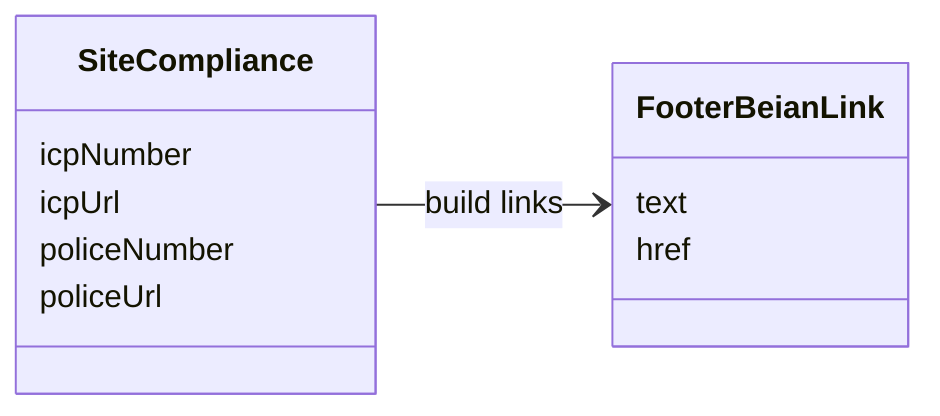

# REASONS Canvas · ICP 合规上线（页脚 / HTTPS / 资产）

- Date: 2026-10-21
- Status: active
- Related analysis: `docs/spdd/analysis/20261021-icp-filing.md`
- Related ADR: `docs/spdd/2-adr决策/ADR-20261021-icp-compliance.md`
- Related tests: `3-测试边界/404home-icp-compliance.md` · `4-测试条例/404home-icp-compliance-cases.md`
- Code anchors: `404home/src/components/AppFooter.vue`、`404home/src/config/siteCompliance.js`、`docs/spdd/rag/knowledge/404home-deploy.md`

---

## R · Requirements（为什么、范围）

### Business goal

ICP 已通过（`粤ICP备2026157903号`）。工程交付：页脚合规悬挂、配置可演进公安号、资产与 Trial D11 对齐；运维侧在域名可直连后上 HTTPS。管局材料提交仍由主办者完成（已完成 ICP）。

### In scope

- 站点合规配置 + `AppFooter` 渲染 ICP（及可选公安）
- 公开页脚去掉「管理后台」外链
- ADR / 测试 / deploy RAG / Trial D11 修订
- 部署前端使生产页脚生效；域名可达时尝试 certbot（失败则文档记待办）

### Out of scope

- 重做备案申请材料；经营性 ICP 证
- 微信 OAuth、计费规则改动
- 自动提交公安备案

### Acceptance criteria

- [ ] 配置源单一；页脚展示主体号并链工信部
- [ ] 公安空则不显示；非空可显示
- [ ] P0 单元测绿
- [ ] deploy 知识含悬挂与 HTTPS 步骤；D11 已修订
- [ ] 生产部署含新 Footer（或记录阻塞原因）

---

## E · Entities（领域对象）

| Entity | Fields / meaning | Persistence |
| --- | --- | --- |
| SiteCompliance | `icpNumber`、`icpUrl`、`policeNumber?`、`policeUrl?` | 前端配置常量 / env |
| FooterBeianLink | 展示用 `{ text, href }` | 派生 |

---

## A · Approach（方案与取舍）

### Chosen approach

1. `siteCompliance.js` 导出号与 URL；`buildIcpLink` / `buildPoliceLink` 纯函数供 Footer 与测试。
2. Footer 只读配置渲染；去掉 `/admin` 公开链。
3. HTTPS 不改业务代码：运维 certbot；失败不阻塞页脚交付。

### Alternatives considered

| Option | Pros | Cons | Decision |
| --- | --- | --- | --- |
| 继续硬编码 Footer | 快 | 公安号难演进 | 否，抽配置 |
| 后端 API 下发备案号 | 可热更 | 过重 | 否 |

---

## S · Structure（结构与依赖）

### Modules / files to touch

| Path | Change |
| --- | --- |
| `docs/spdd/2-adr决策/ADR-20261021-icp-compliance.md` | 已接受 |
| `docs/spdd/3-测试边界/404home-icp-compliance.md` | 已写 |
| `docs/spdd/4-测试条例/404home-icp-compliance-cases.md` | 已写 |
| `docs/spdd/3-测试边界/README.md` 等索引 | 挂模块 |
| `docs/spdd/1-资产规范/404home-deepseek-trial.md` | D11 |
| `docs/spdd/rag/knowledge/404home-deploy.md` | 悬挂/HTTPS |
| `404home/src/config/siteCompliance.js` | 新建 |
| `404home/src/config/siteCompliance.spec.js` | P0 |
| `404home/src/components/AppFooter.vue` | 读配置 |
| 部署脚本 / 生产 | 发布 dist |

### Dependencies / order

ADR → 测试资产 → 规范/RAG → 红测 → 配置+Footer → 部署/HTTPS 尝试

---

## O · Operations（有序实现步骤）

### Op 1 · 索引与 D11 / deploy 知识

- **Files**: README 索引、`404home-deepseek-trial.md`、`404home-deploy.md`、analysis Related canvas
- **Do**: 挂模块；D11 改为备案后域名+HTTPS；deploy 写清配置键与悬挂要求。
- **Done when**: 文档可检索到 ICP 交付约定。

### Op 2 · TDD 合规配置

- **Files**: `siteCompliance.js` + `.spec.js`
- **Do**: 先红后绿，覆盖 TC-01–03。
- **Done when**: `npm run test:unit` 相关用例绿。

### Op 3 · Footer 接配置

- **Files**: `AppFooter.vue`
- **Do**: 渲染 ICP；条件渲染公安；去掉管理后台链；文案偏个人导航。
- **Done when**: 本地页脚可见主体号链接。

### Op 4 · 部署与 HTTPS 尝试

- **Files**: 生产 dist；必要时 nginx/certbot（服务器）
- **Do**: 按 `deploy.local.md` 发布；域名可访问则 certbot。
- **Done when**: 生产 IP/域名页脚有号；HTTPS 成功或明确记阻塞。

---

## N · Norms（怎么写）

- 备案号只从 `siteCompliance` 读；外链 `rel="noopener noreferrer"`。
- 不把证件/手机号写入仓库。
- 测试用 vitest 测纯函数，不测管局流程。

---

## S · Safeguards（不许做什么）

- Must not: git 提交备案材料；公开页脚链 `/admin`；未备案时对外强推域名（历史风险，现 ICP 已过）。
- Security: 部署密钥仅 `deploy.local.md`。
- Rollback: Footer 可回退硬编码号；证书失败不影响 HTTP。

---

## Sync log

| Date | Drift | Action |
| --- | --- | --- |
| 2026-10-21 | 新建 | active → generate |
