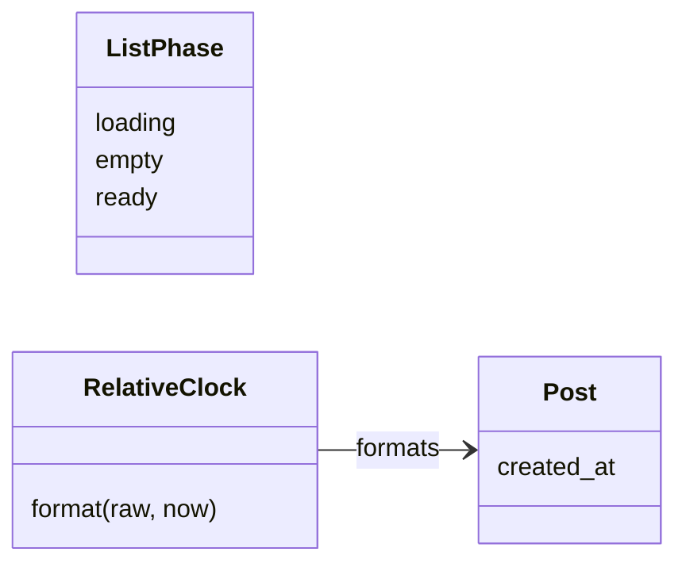

# REASONS Canvas · UX Week A：加载空闪 / 等待态 / 时间戳信任

- Date: 2026-10-21
- Status: synced
- Related analysis: `docs/spdd/analysis/20261021-forty40-ux-review.md`（UX-01 · UX-02 · UX-03）
- Related ADR: 无新 ADR（对齐既有首页 Feed；纯可用性修复）
- Related tests: `3-测试边界/404home-ux-loading-trust.md` · `4-测试条例/404home-ux-loading-trust-cases.md`
- Code anchors: `404home/src/views/Home.vue`、`ToolDetail.vue`、`Search.vue`、`PostDetail.vue`、`Category.vue`、`ArticleCard.vue`、`404home/src/utils/*`、`404home/server/seed.js`

---

## R · Requirements（为什么、范围）

### Business goal

消除「站点没内容」误判与「批量入库」时间戳不信任，让首屏与详情在慢网上始终有明确等待态。

### In scope

- UX-01：首页（及同类列表）请求未完成只显示 skeleton；仅 `!loading && length===0` 显示空文案。
- UX-02：`ToolDetail` / `Search` / `PostDetail`（及 `Category`）骨架或明确等待态；失败可重试。
- UX-03：seed 避免大批同秒 `created_at`；列表/详情用相对时间（或日期，不展示秒）。

### Out of scope

- UX-04～UX-10（首屏 IA、热门配额、详情决策字段、Trial 预览等）
- 新 UI 库、改色板、真爬虫发布时间回填

### Acceptance criteria

- [x] 刷新 `/` 不再短暂出现「该分类暂无文章 / 暂无热门工具 / 暂无热榜」
- [x] `/tool/:slug`、`/search`、`/news/:id` 加载中有骨架（非仅「加载中…」纯文字也可接受骨架优先）
- [x] 详情加载失败有「重试」
- [x] 文章卡/详情时间为人话相对时间或日期，不带秒
- [x] seed 后已发布文的 `created_at` 不致高度撞车（自动化断言）
- [x] P0 条例对应用例绿

---

## E · Entities（领域对象）

| Entity | Fields / meaning | Persistence |
| --- | --- | --- |
| ListPhase | `loading` \| `empty` \| `ready` | 前端派生 |
| RelativeClock | 将 `created_at` 格式化为相对/日期文案 | 纯函数 |
| Post.created_at | SQLite 文本时间；seed 打散 | `posts.created_at` |

---

## A · Approach（方案与取舍）

### Chosen approach

1. 抽极薄 `listPhase(loading, length)` 与 `formatRelativeTime(raw, now)`，Vitest 锁行为；视图只消费结果。
2. Home / Category：`loading` 初值 true；骨架块复用同一套 CSS class。
3. Detail / Search：骨架 + `error` + 重试按钮（重跑 load）。
4. seed：新插入带错开的 `created_at`；若库内时间戳区分度过低则一次性打散（不覆盖已合理分散的数据）。

### Alternatives considered

| Option | Pros | Cons | Decision |
| --- | --- | --- | --- |
| 仅改 v-if 不加骨架 | 更少 CSS | 慢网仍空白 | 否，要 skeleton |
| 全站 Vue 组件测试 | 覆盖 UI | 脚手架成本高 | 否，测纯函数 + seed |
| 一律改写全部 created_at | 简单 | 踩 admin 手改时间 | 否，条件打散 |

---

## S · Structure（结构与依赖）

### Modules / files to touch

| Path | Change |
| --- | --- |
| `docs/spdd/3-测试边界/404home-ux-loading-trust.md` | 边界 |
| `docs/spdd/4-测试条例/404home-ux-loading-trust-cases.md` | 条例 |
| `docs/spdd/3-测试边界/README.md` / `4-测试条例/README.md` | 索引 |
| `docs/spdd/analysis/20261021-forty40-ux-review.md` | 看板状态 |
| `404home/src/utils/listPhase.js` + `.spec.js` | UX-01 判定 |
| `404home/src/utils/formatRelativeTime.js` + `.spec.js` | UX-03 UI |
| `404home/src/views/Home.vue` | loading + skeleton + 空态门闩 |
| `404home/src/views/Category.vue` | 同上 |
| `404home/src/views/ToolDetail.vue` | skeleton + retry |
| `404home/src/views/Search.vue` | skeleton |
| `404home/src/views/PostDetail.vue` | skeleton + retry + 相对时间 |
| `404home/src/components/ArticleCard.vue` | 相对时间 |
| `404home/server/seed.js` | 打散 created_at |
| `404home/server/test/ux-loading-trust-p0.test.js` | seed 时间戳 P0 |

### Dependencies / order

1. 测试边界 + 条例
2. 失败测试（listPhase / formatRelativeTime / seed 时间）
3. 绿：utils → seed → 视图接线
4. 回写 UX review 看板

---

## O · Operations（有序实现步骤）

### Op 1 · 资产与失败测试

- **Files**: 边界/条例/README；`listPhase.spec.js`；`formatRelativeTime.spec.js`；`ux-loading-trust-p0.test.js`
- **Do**: 按条例写红测
- **Done when**: `npm run test:unit` / 相关 server 测失败原因正确

### Op 2 · 纯函数与 seed

- **Files**: `listPhase.js`、`formatRelativeTime.js`、`seed.js`
- **Do**: 最小实现使红测变绿
- **Done when**: 相关自动化全绿

### Op 3 · 首页与分类空闪

- **Files**: `Home.vue`、`Category.vue`
- **Do**: `loading` + skeleton；空文案门闩 `listPhase === 'empty'`
- **Done when**: 手测刷新不再闪空

### Op 4 · 详情/搜索等待与重试

- **Files**: `ToolDetail.vue`、`Search.vue`、`PostDetail.vue`
- **Do**: 骨架；失败重试；文章时间用相对格式
- **Done when**: 慢网/断接口可见等待或重试

### Op 5 · 列表相对时间 + 看板

- **Files**: `ArticleCard.vue`、UX review
- **Do**: 卡面相对时间；UX-01～03 → done
- **Done when**: 看板勾选完成

---

## N · Norms（怎么写）

- Stack conventions: Vue 3 Options/setup 既有风格；CSS 变量；无新依赖
- UI / naming: skeleton class 统一 `skeleton` / `skeleton-line`；空文案文案不改义
- Testing: Vitest 测纯函数；server node:test 测 seed 时间分散
- 相对时间：中文「刚刚 / N 分钟前 / N 小时前 / N 天前」；≥7 天用 `YYYY-MM-DD`

---

## S · Safeguards（不许做什么）

- Must not: 改首页 IA（UX-04）、砍热门工具区、引入 UI 框架
- Must not: 每次 seed 无条件覆盖全部 `created_at`
- Security: 重试仅重拉公开 API，不绕鉴权
- Rollback: 仅前端态 + seed 时间；可回滚视图改动

---

## Sync log

| Date | Drift | Action |
| --- | --- | --- |
| 2026-10-21 | 自 UX review 拆 Week A | 建画布 |
| 2026-10-21 | 实现 UX-01～03 | 标记 synced；看板 done |
