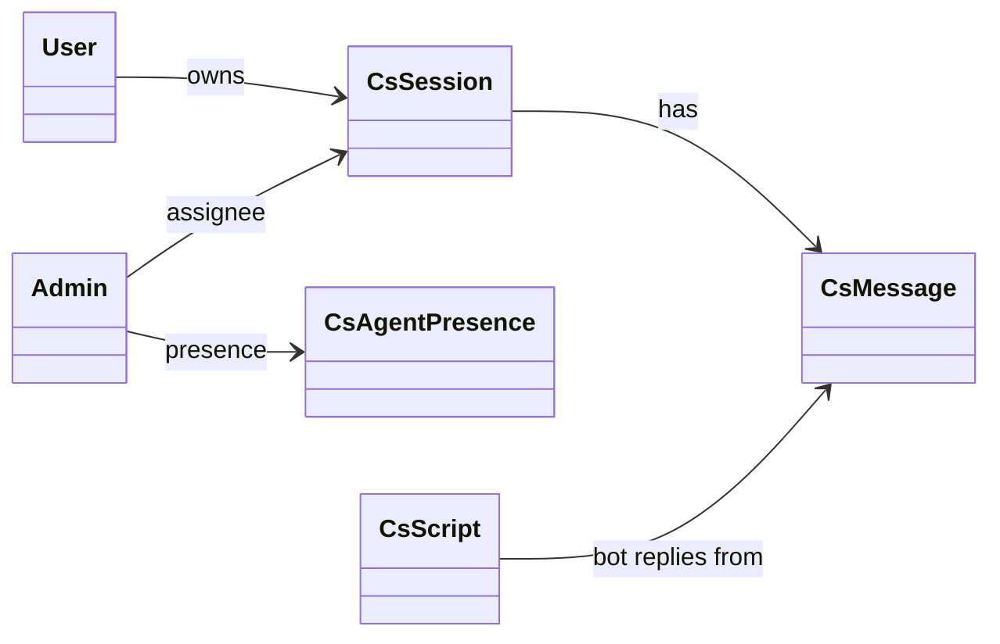

# REASONS Canvas · 全站客服（话术 + 转人工）

- Date: 2026-10-24
- Status: active
- Related analysis: `docs/spdd/analysis/20261024-customer-service.md`
- Code anchors: `404home/server/routes/cs.js`, `404home/server/db.js`, `404home/src/components/CsWidget.vue`, `404home/src/views/admin/CsWorkbench.vue`

---

## R · Requirements（为什么、范围）

### Business goal

全站可聊机器人客服（固定话术），并支持转人工由管理员/客服在同一会话接过；体验接近淘宝默认客服。

### In scope

- 右下角入口；桌面侧栏 / 手机抽屉
- 游客自动账号「游客_」+ 后缀；登录用户复用 user JWT
- FAQ 按钮 + 关键词话术；后台可 CRUD 话术
- 转人工 + 在线分配；无人则排队安慰语
- 后台三栏工作台 + 「我在线」
- 管理员全局设置（本期：话术模式开关/文案类配置位，预留 AI）

### Out of scope

- AI 自动回复
- 独立客服角色、排班
- WebSocket/SSE
- 客服消息扣钱包

### Acceptance criteria

- [x] 游客首次开聊生成并持久化游客身份与 JWT（localStorage）
- [x] FAQ 点击与关键词命中均返回对应话术
- [x] 转人工：有在线 admin → 会话 `human` + `assignee_admin_id`；无人 → 系统安慰语，状态 `queued`
- [x] 被分配的 admin 可发消息；用户浮层轮询可见
- [x] `/admin/cs` 三栏可用；「我在线」只影响分配池
- [x] 与 `/api/chat` 试用通道隔离；客服不计费
- [x] P0 自动化覆盖 guest bootstrap、话术匹配、转人工分配/排队、admin 回复权限

---

## E · Entities（领域对象）

| Entity | Fields / meaning | Persistence |
| --- | --- | --- |
| CsGuest / User | 游客：`email` 占位 `guest_<suffix>@guest.local`，`display` 名存扩展或 email 前缀展示为 `游客_<suffix>` | `users` + flag/`guest` 约定 |
| CsSession | `user_id`, `status`=`bot\|queued\|human\|closed`, `assignee_admin_id`, timestamps | `cs_sessions` |
| CsMessage | `session_id`, `role`=`user\|bot\|agent\|system`, `admin_id?`, `content` | `cs_messages` |
| CsScript | `title`, `faq_label?`, `keywords` JSON, `body`, `sort`, `enabled` | `cs_scripts` |
| CsAgentPresence | `admin_id`, `online`, `updated_at` | `cs_agent_presence` |
| CsSettings | key/value：`mode`=`scripts`（预留 `ai`）, `queue_message` | `cs_settings` |

---

## A · Approach（方案与取舍）

### Chosen approach

独立 `cs_*` 表与 `/api/cs/*`；游客写入 `users`（guest 邮箱约定）发 user JWT；实时用客户端短轮询；admin JWT 接单。

### Alternatives considered

| Option | Pros | Cons | Decision |
| --- | --- | --- | --- |
| 复用 chat_sessions | 少表 | 与计费/DeepSeek 纠缠 | 否 |
| 纯匿名 cookie 无 user 行 | 轻 | 后台难统一用户模型 | 否，游客也进 users |
| WebSocket | 低延迟 | 运维与复杂度 | 下期；本期 poll |

### Builder calls

- 游客后缀：6 位 base36；展示名 `游客_<suffix>`
- 轮询：用户/客服默认 2500ms
- 关键词：子串包含、大小写不敏感；多命中取 `sort` 最小
- 未命中：固定兜底话术（可配置 `fallback_message`）

---

## S · Structure（结构与依赖）

### Modules / files to touch

| Path | Change |
| --- | --- |
| `docs/spdd/2-adr决策/ADR-20261024-customer-service.md` | 新建 |
| `docs/spdd/3-测试边界/404home-customer-service.md` | 新建 |
| `docs/spdd/4-测试条例/404home-customer-service-cases.md` | 新建 |
| `docs/spdd/1-资产规范/404home-customer-service.md` | 新建 |
| `404home/server/db.js` | `cs_*` 表 |
| `404home/server/routes/cs.js` | API |
| `404home/server/app.js` | mount |
| `404home/server/test/cs-p0.test.js` | P0 |
| `404home/src/api/index.js` | cs client |
| `404home/src/components/CsWidget.vue` | 浮层 |
| `404home/src/composables/useCsWidget.js` | 状态/轮询 |
| `404home/src/layouts/MainLayout.vue` | mount widget |
| `404home/src/views/admin/CsWorkbench.vue` | 三栏 |
| `404home/src/views/admin/CsScripts.vue` | 话术配置（可同页 Tab） |
| `404home/src/layouts/AdminLayout.vue` + `router` | 导航 |

### Dependencies / order

1. ADR + 测试边界/条例（+ 规范摘要）
2. DB + 失败中的 P0 测试
3. routes/cs.js 绿
4. 用户浮层
5. 后台工作台 + 话术管理
6. spdd-sync 若有漂移

---

## O · Operations（有序实现步骤）

### Op 1 · ADR + 测试资产

- **Files**: `2-adr决策/ADR-20261024-customer-service.md`, `3-测试边界/404home-customer-service.md`, `4-测试条例/404home-customer-service-cases.md`, `1-资产规范/404home-customer-service.md`
- **Do**: 按资产序落文档
- **Done when**: 文件齐全，条例含 P0 用例编号

### Op 2 · DB + P0 红测

- **Files**: `server/db.js`, `server/test/cs-p0.test.js`, `server/test/helpers.js`（如需）
- **Do**: 建表；写 guest bootstrap / match / transfer online|offline / agent reply 测试并确认失败
- **Done when**: 测试因缺路由/表而失败（正确失败）

### Op 3 · CS API

- **Files**: `server/routes/cs.js`, `server/app.js`
- **Do**: 实现下方 API；话术匹配与分配逻辑
- **Done when**: `cs-p0` 全绿

### Op 4 · 用户浮层

- **Files**: `CsWidget.vue`, `useCsWidget.js`, `MainLayout.vue`, `api/index.js`
- **Do**: 气泡 + 响应式面板；FAQ/输入/转人工/轮询
- **Done when**: 手动或组件级可开聊；游客 token 落盘

### Op 5 · 后台工作台

- **Files**: `CsWorkbench.vue`, `AdminLayout.vue`, `router/index.js`；话术 CRUD UI
- **Do**: 三栏 + 在线开关 + 回复；话术管理
- **Done when**: admin 可配置话术、上线、接单回复

---

## API sketch

| Method | Path | Auth | Behavior |
| --- | --- | --- | --- |
| POST | `/api/cs/guest` | none | 创建/复用游客 user + JWT |
| GET | `/api/cs/scripts/faq` | optional user | 启用 FAQ 列表 |
| POST | `/api/cs/sessions` | user | 开或取当前开放会话 |
| GET | `/api/cs/sessions/:id/messages` | user owner | 消息 + status |
| POST | `/api/cs/sessions/:id/messages` | user owner | 用户消息 → bot 话术或（human 时）仅落库 |
| POST | `/api/cs/sessions/:id/transfer` | user owner | 转人工 |
| GET | `/api/cs/admin/inbox` | admin | 会话队列 |
| GET | `/api/cs/admin/sessions/:id` | admin | 详情+消息 |
| POST | `/api/cs/admin/sessions/:id/messages` | admin | 人工回复（须 assignee 或抢接规则：仅 assignee） |
| POST | `/api/cs/admin/presence` | admin | `{ online: bool }` |
| GET | `/api/cs/admin/presence` | admin | 自己与在线列表 |
| CRUD | `/api/cs/admin/scripts` | admin | 话术 |
| GET/PUT | `/api/cs/admin/settings` | admin | 全局设置 |

---

## N · Norms（怎么写）

- Stack: 现有 Express 路由风格、`userRequired` / `adminRequired`
- 错误：`{ error, code }`；HTTP 401/403/404/409
- UI：跟站点现有 CSS 变量；浮层不引入新依赖
- Testing: `node --test` P0 与现有 `helpers.js` 一致；`DEEPSEEK` 无关

---

## S · Safeguards（不许做什么）

- Must not: 改试用 `/api/chat` 计费路径；客服扣余额
- Must not: user JWT 访问 admin CS；伪造 assignee
- Security: 游客 JWT 与正式用户同中间件；不可枚举改他人 session
- Rollback: 新表可空；feature 由前端挂载控制
- Explicit: 无人在线 transfer → 200 + system queue message，非 5xx

---

## Sync log

| Date | Drift | Action |
| --- | --- | --- |
| 2026-10-24 | 初建 | active |
